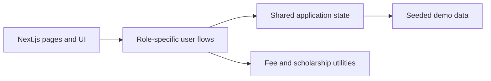

# EduFee360 — School Fee Management SaaS Demo

A multi-role **Next.js, React and TypeScript** product prototype focused on school fees, collections, parent communication and administrative workflows. Designed as a functional SaaS demonstration—not a live payment or student-information system.

## Product walkthrough

| Area | Demonstrated workflows |
| --- | --- |
| Student administration | Student profiles, fees, installment plans and scholarships |
| School finance | Due tracking, fines, receipts and simulated payment flows |
| Parent experience | Parent-facing views and communications |
| Operations | Reporting, support tickets, staff and school administration |
| AI concepts | Collection-assistant and notification workflow simulations |
| Multi-tenancy | Super-admin views and role-based product demonstration |

**Roles represented:** Super Admin, School Admin, Accountant, Support Agent, Parent, and Student.

> **Important:** Payment gateway options and AI interactions in this repository are **simulations**, not production integrations. The prototype uses in-browser state rather than a live multi-tenant backend. Do not use it for real student records or payments.

## Stack

- **Framework:** Next.js 16 (App Router), React 19, TypeScript
- **UI:** Tailwind CSS 4, Framer Motion, Lucide React
- **Application data:** In-browser demo state and local seed data
- **Quality tooling:** ESLint, TypeScript, GitHub Actions and Dependabot (proposed)

## Quick start

Requires Node.js 22 and npm.

```bash
git clone https://github.com/Rizwankhan0001/school-hub.git
cd school-hub
npm ci
npm run dev
```

Open [http://localhost:3000](http://localhost:3000).

## Architecture



The `src/app/` directory contains route groups for admin, parent, platform and account flows; `src/components/` contains reusable UI, and `src/lib/` provides domain models and fee/scholarship logic.

## Quality checks

```bash
npm run lint
npx tsc --noEmit
npm run build
```

Proposed GitHub Actions runs these checks on push and pull requests. A passing check confirms the app builds, not that real payment processing or persistence is implemented.

## From prototype to production

Priorities before real-world use:

1. Server-side authentication, authorization and role enforcement
2. Persistent tenant-isolated storage and audit trails
3. Payment-provider integrations with verified server-side webhooks
4. Automated unit, integration and browser tests
5. Accessibility and security testing with synthetic student data
6. Data protection and operational review appropriate for schools

## Portfolio notes

This project illustrates translating a product requirements document into a structured multi-role interface. It is intentionally presented as a **functional product demo**, not a production-ready SaaS service.
